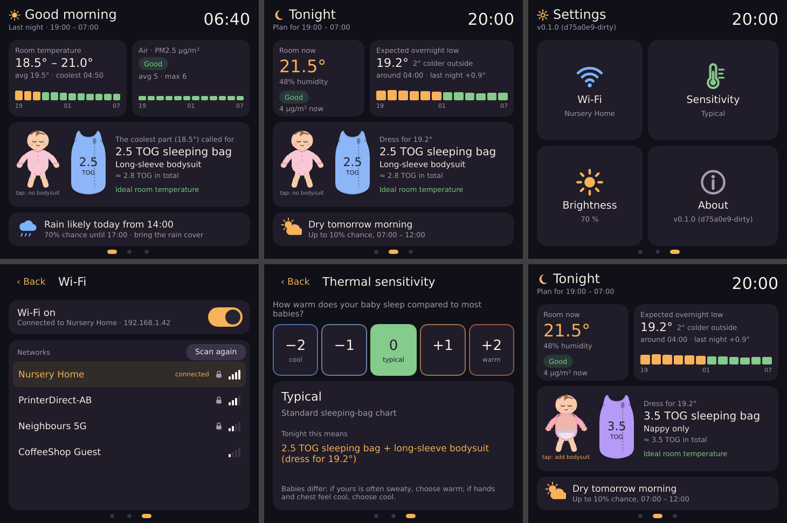

# Presto examples

## Putting an example on the Presto

```
./flash.sh            # the nursery display
./flash.sh touch      # any other example
```

- **USB, no extra hardware:** hold the Presto's **BOOT/user button** while plugging in USB (or
  while pressing RESET). The RP2350 appears as a drive called `RP2350`. The script waits for it,
  copies the firmware (`elf2uf2-rs`), and the board restarts into it.
- **Debug probe** (e.g. a Raspberry Pi Debug Probe on the SWD pads): if one is attached, the
  script uses `probe-rs` instead, which also streams the `defmt` log to your terminal. The same
  happens with `cargo run --release --bin <name>`.

| Example | What it does |
| --- | --- |
| `nursery` | The nursery display (below). |
| `lcd_test_pattern` | Display bring-up: a pattern that exercises every data line, plus a block redrawn every second while the CPU hammers SRAM. The emulator harness checks this binary. |
| `touch` | Logs touch reports. |
| `leds` | Rainbow on the SK6812 strip. |
| `speaker` | Plays a tune on the piezo. |
| `lcd_pin_id` | Pulses the LCD control pins in turn, for checking them with a logic analyser. |

## Nursery display

A bedside screen for a baby's room. **Swipe left and right** (or tap the dots at the bottom) to
move between three pages:

1. **Morning:** last night's room temperature and air quality (PM2.5, hourly bars), what the
   coolest part of the night called for, and whether it will rain today.
2. **Tonight:** the room now, the expected overnight low, what to wear, and rain for the
   morning walk.
3. **Settings**, four large buttons:
   - **Wi-Fi:** switch the radio on or off (off means the module is unpowered and transmits
     nothing), pick a network, and type the password on the on-screen keyboard.
   - **Sensitivity:** five steps from "runs cool" to "runs warm". Each step dresses the baby as
     if the room were 1 °C cooler or warmer.
   - **Brightness:** 10–100 %.
   - **About:** firmware version, sensors found, Wi-Fi MAC and IP address, uptime, memory.

**Tap the sleeping bag** for a night without it. The bag is then drawn faded, and the
recommendation makes up the missing insulation with warmer clothes over the bodysuit (or says to
use the bag if even a sleepsuit is not enough; it never suggests loose blankets). Tap the faded
bag to bring it back.

The screen picks Morning (05:00–11:00) or Tonight by time of day, and turns off after
3 minutes without a touch. Touch the screen or press the button to wake it. **Tap the time** to
set the clock by hand. Settings, the sleeping-bag choice and the Wi-Fi network are saved in flash.



### How tonight is predicted

- **Last night's curve** (when at least 60 % of last night was recorded): tonight follows last
  night's measured curve, shifted by how much warmer or cooler the room is now than at the same
  time yesterday. This works without Wi-Fi.
- **With a forecast:** the shift grows through the night by 15 % of the difference between
  tonight's and last night's outdoor low, so a colder night outside means a colder room.
- **No history yet:** an estimate of a 1.5 °C drop to a low at 05:00, deeper on cold nights.

The card says which method was used ("last night +0.9°", "estimate"). The logic is
`nursery-core/src/planner.rs`.

### Try it on your Mac first

```
cd nursery-desktop
cargo run                      # the screen plus a controls window (sliders for every input)
cargo run -- cold              # start from a preset
cargo run -- --screenshot out.png wifi      # render headlessly, exactly as the panel will
```

- **Presets:** evening, morning, cold, hot, smoky, stuffy, no-sensors, no-wifi, no-bag, settings,
  wifi, sensitivity, brightness, about.
- **Simulated Wi-Fi:** the radio switch works, scans find four networks, and passwords shorter
  than 8 characters are rejected. The forecast only arrives while "connected", as on the device.
- **Brightness preview:** brightness dims the window.

The simulator uses the same `nursery/ui/nursery.slint`, the same `nursery/app.rs` logic, and the
same RGB565 software renderer as the device, so what you tune there is what you get. To inspect
the running UI over MCP, build with `--features mcp` and run with
`SLINT_EMIT_DEBUG_INFO=1 SLINT_MCP_PORT=9315`.

Where things live:

- `nursery/ui/nursery.slint` is the layout. Illustrations are in `nursery/ui/img/`.
- `nursery/app.rs` maps state to UI text (shared by firmware and simulator).
- `src/bin/nursery/` is the firmware: `main.rs` (UI loop), `wifi.rs` (radio, DHCP, HTTP) and
  `storage.rs` (settings in flash).
- `nursery-core/` is the logic, unit tested on the host (`cd nursery-core && cargo test`):
  - `sleepwear.rs`: the TOG ladder, sensitivity and the no-sleeping-bag adaptation.
  - `planner.rs`: the overnight estimate.
  - `history.rs`: the night summary.
  - `air.rs`: PM2.5 and CO₂ categories.
  - `net.rs`: HTTP, forecast and location parsing.
  - `settings.rs`: the flash format.

### Hardware

| Part | Connection | Notes |
| --- | --- | --- |
| PMSA003I PM2.5 sensor | Qwiic / STEMMA QT (I2C 0x12) | Readings are ignored for 30 s after power-up while the fan settles. I2C runs at 100 kHz. |
| SCD40 CO₂ + temperature + humidity | Qwiic, daisy-chained (I2C 0x62) | **Needed for temperature.** The PMSA003I measures particles only. Keep it away from the Presto and other warm parts (it already subtracts 4 °C of self-heating), and air the room now and then: it recalibrates assuming it sees outdoor air (≈420 ppm) about once a week. |
| RM2 Wi-Fi (on the Presto) | PIO2, GPIO23/24/25/29 | Firmware blobs in `nursery/cyw43-firmware/`. |

Either sensor can be missing; the screen says what it cannot show.

**Network use (Wi-Fi on).** Everything is plain HTTP, because the device has no TLS:

- **Location:** looked up once from the public IP via `ip-api.com`, or set at build time with
  `NURSERY_LAT=52.52 NURSERY_LON=13.41 ./flash.sh`.
- **Forecast:** fetched hourly from `api.open-meteo.com`, including the local UTC offset.
- **Clock:** set from the `Date` header of those responses.

The Wi-Fi password is stored unencrypted in the last flash sector.

Memory: the 450 KiB frame buffer lives in PSRAM. Core 1 does nothing but feed the panel from
a 64 KiB SRAM copy of the next few dozen lines (see the top-level README). The Slint heap, the Wi-Fi driver and the network buffers stay in SRAM, because the
RP2350 cannot do atomic operations on PSRAM. The firmware stops with a clear panic if PSRAM is
not detected.

To check the display under load, build with `NURSERY_STRESS=1 ./flash.sh`. The firmware then
redraws the whole screen continuously for 30 s. Every 10 s it logs `ring underruns`,
`FIFO stalls` and `late frames`, which should all stay at or near 0.

**If flashing with the probe fails** ("verify failed", or the probe reports mismatched command
IDs) and the board then stays dark, unplug the Presto's USB-C for a few seconds. A reset that
lands in the middle of a PSRAM transfer can leave the PSRAM driving the shared QSPI bus, which
only a power cycle clears. `flash.sh` runs `prepare-flash.sh` first, which stops the display
DMA and PIO so this is unlikely.

The sleepwear ladder follows the room-temperature charts that sleeping-bag makers publish, and
the Lullaby Trust's advice to aim for a 16–20 °C room. Tune `LADDER` in
`nursery-core/src/sleepwear.rs` if your guidance differs.
